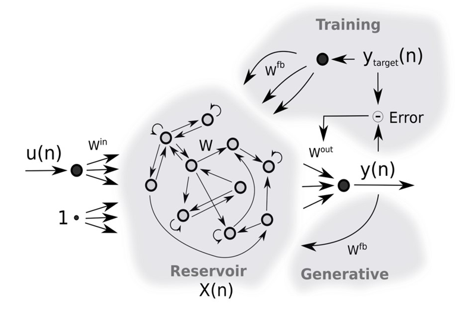

# esn-change-detection

Official implementation of [*Enhanced Detection of Human-Driven Forest Alterations using Echo State Networks*](https://neurips.cc/virtual/2024/100568) (Tomás Couso Coddou, Paula Aguirre, Rodrigo A. Carrasco, Javier Lopatin), NeurIPS 2024 Workshop on Tackling Climate Change with Machine Learning.

The method detects human-driven changes in woodlands (logging, fire) from Landsat NDVI time series, telling them apart from drought-induced browning and stable vegetation in central Chile. An Echo State Network models the expected NDVI dynamics of each pixel, and sustained deviations from its predictions are flagged as changes.

<p align="center">
  
</p>

<p align="center"><em>Echo state network: a fixed random reservoir, with only the readout <code>W<sup>out</sup></code> trained. The feedback connections <code>W<sup>fb</sup></code> are optional; this code uses the non-feedback network. Figure from <a href="https://ieeexplore.ieee.org/abstract/document/9205191">Cho et al. (2020)</a>.</em></p>

## Two versions

The workshop manuscript and the workshop poster describe two stages of the same work, so each has its own self-contained directory. They share no code and are installed separately.

| | [`manuscript/`](manuscript) | [`poster/`](poster) |
|---|---|---|
| Corresponds to | [the workshop manuscript (PDF)](https://ccai-papers.s3.us-east-1.amazonaws.com/neurips2024/77/paper.pdf) | [the workshop poster](https://neurips.cc/virtual/2024/100568) |
| Detection | per-pixel lower bound from an ESN fine-tuned step by step; N consecutive forecasts below `k` times the bound | one global ESN; windows where the prediction error exceeds `k` times the RMSE |
| Polygon decision | fraction of flagged pixels against `th` | fraction of pixels detected inside the annotated event window against `th` |
| Reservoir / input | 500 units, 104 weekly values | 1000 units, 48 values at 16-day sampling |

The dataset is not public, so neither version can be reproduced end to end. Each directory documents the input format it expects and includes a generator of synthetic data to exercise the code.

## References

The change detection scheme adapts the fault detection method of:

A. D. Cho, R. A. Carrasco, G. A. Ruz and J. L. Ortiz, "Slow Degradation Fault Detection in a Harsh Environment," *IEEE Access*, vol. 8, pp. 175904-175920, 2020, doi: [10.1109/ACCESS.2020.3026348](https://doi.org/10.1109/ACCESS.2020.3026348).

## Citation

```bibtex
@inproceedings{couso2024enhanced,
  title     = {Enhanced Detection of Human-Driven Forest Alterations using Echo State Networks},
  author    = {Couso Coddou, Tom{\'a}s and Aguirre, Paula and Carrasco, Rodrigo A. and Lopatin, Javier},
  booktitle = {NeurIPS 2024 Workshop on Tackling Climate Change with Machine Learning},
  year      = {2024},
  url       = {https://neurips.cc/virtual/2024/100568}
}
```
