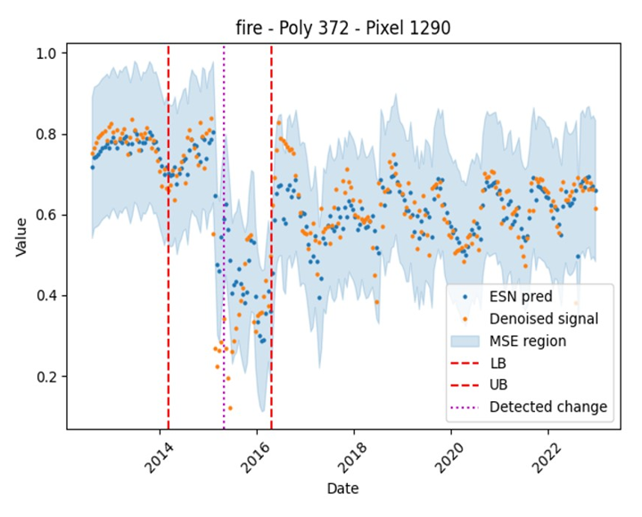
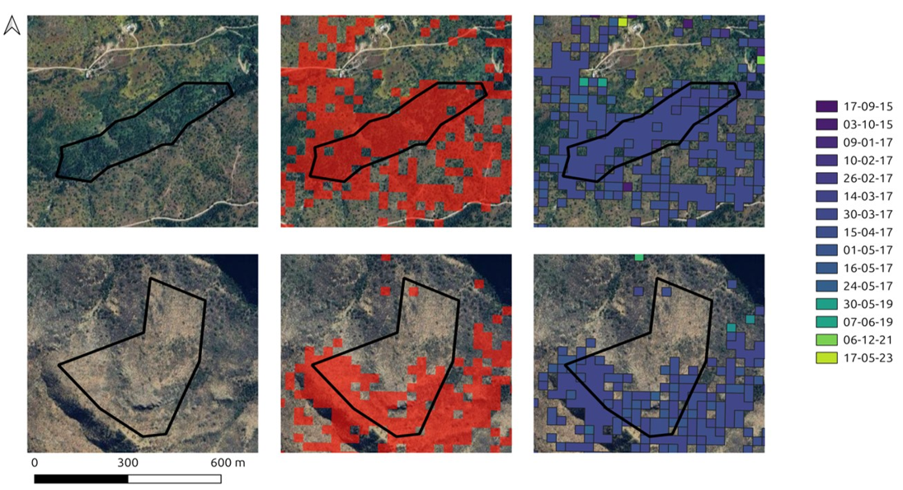

# Poster version

Code for the method as presented in the [workshop poster](https://neurips.cc/virtual/2024/100568) of *Enhanced Detection of Human-Driven Forest Alterations using Echo State Networks*. The version described in the workshop manuscript is in [`../manuscript`](../manuscript).

This directory is an extract of the author's original development repository, taken at its state of December 2024. Commit history, trained models and results were left out, and the dataset is not included because it is not public.

## Method

For each pixel, an Echo State Network predicts the next NDVI value from the previous values, and sustained deviations from its predictions are flagged as changes.

1. The NDVI series is denoised: resampled to a 16-day grid (median) and filtered with a moving standard deviation filter.
2. One global ESN (1000 units, leaking rate 0.5, spectral radius 0.9, RLS readout) is trained on the first 80% of the series of every pixel before `training_limit_date` (2010-01-01). It predicts the next value from the previous 48 (about two years).
3. In the test period (from 2010), the ESN predicts every step of each pixel's series, which gives a predicted signal next to the true one.
4. A window of `N` steps is flagged when, in at least `majority_threshold` of its steps, the prediction exceeds the true signal by more than `k` times the pixel's RMSE. The start of each run of flagged windows is a detection.
5. A pixel is classified as changed if a detection falls inside its annotated event window, extended by `slack_weeks_for_event_date`. Pixels of stable and drought polygons are classified as changed if they have any detection.
6. `N` and `k` are selected by grid search on four reserved polygons (`param_iteration_poly_ids`). The remaining polygons are the test set, where each polygon is labelled by voting: it is changed if the fraction of its changed pixels exceeds `voting_threshold`.

All parameters are in `config/params.yaml`.

<p align="center">
  
</p>

## Repository structure

```
config/params.yaml                                  all hyperparameters
src/data/make_synthetic_dataset.py                  synthetic dataset in the expected format
src/data/annotate.py                                add annotated event dates to the metadata
src/data/filter.py                                  intended to discard polygons that changed before the training period
src/data/make_train_test_datasets.py                split signals at training_limit_date
src/features/                                       denoising and feature/target windows
src/training/                                       ESN training
src/inference/simulation/                           per-pixel ESN predictions, stored in a SQLite database
src/inference/change_detection/                     detection rule, over the parameter grid and with the optimal parameters
src/inference/detect_over_rasters.py                detection over raster time series
src/metrics/                                        pixel-level metrics, over the parameter grid and on the test set
src/metrics/test/compute_polygon_voting_scores.py   polygon voting and per event type metrics
src/visualization/                                  metric plots, pixel detection plots, raster maps
run.sh                                              pipeline, from data preparation to plots
```

## Data

The dataset is not distributed. The pipeline expects:

- `data/raw/metadata.csv`: one row per pixel, with columns `ID` (polygon), `IDpix`, `change_type` (`stable`, `drought`, `logging` or `fire`) and `label` (1 for logging and fire, 0 otherwise).
- `data/raw/<band>.csv`: one row per pixel, with columns `ID` and `IDpix` and one column per acquisition date (`YYYY-MM-DD`) holding the band value. Missing observations are empty.
- `data/external/change_poly_annotations.csv`: one row per polygon with a change event, with a `csv` column containing `ID_<polygon id>` and a `label` column with a JSON list whose first element has the `start` and `end` dates of the event.

To exercise the code without the real data, generate a synthetic dataset in this format:

```bash
python src/data/make_synthetic_dataset.py
```

It writes 16 polygons of 3 pixels each (seasonal NDVI with noise, gaps and outliers; a temporary drop for logging, a drop and recovery for fire, a mild dip for drought), including the polygons in `param_iteration_poly_ids`. It is only meant to run the pipeline: results on it are not meaningful.

## Run

```bash
pip install -e .
pip install -r requirements.txt
bash run.sh
```

Intermediate files go to `data/`, `features/`, `database/` and `results/`, the trained ESN to `models/`, and metrics and figures to `reports/`. These directories are kept in the repository empty and their contents are git-ignored.

## Raster detections

`src/inference/detect_over_rasters.py` applies the trained ESN and the detection rule to every pixel of a raster time series, and writes a binary detection raster and a raster with the detection date of each pixel. `src/visualization/test/plot_raster_detections.py` draws quick-look maps from them. The paper figures were rendered separately with QGIS:

<p align="center">
  
</p>

The input rasters are not included: the script expects `data/external/rasters/<name>.tif` (one band per acquisition date) and `data/external/raster_dates/<name>.csv` (a `Formatted Date` column in `YYYY.MM.DD` format), and needs an ESN trained on the real data. No raster results are included either.

## Notes on the poster

- The poster describes the detection threshold as proportional to the mean squared error. The code uses the root mean squared error.
- The polygon labels in the poster tables come from the voting step in `src/metrics/test/compute_polygon_voting_scores.py`, with `voting_threshold: 0.1`.
- The poster also compares NDVI with NBR. The band is selected with `selected_band`; no NBR results are included.
- The ESN prediction metrics (regression R²) are written to `reports/metrics/` by the training step.
